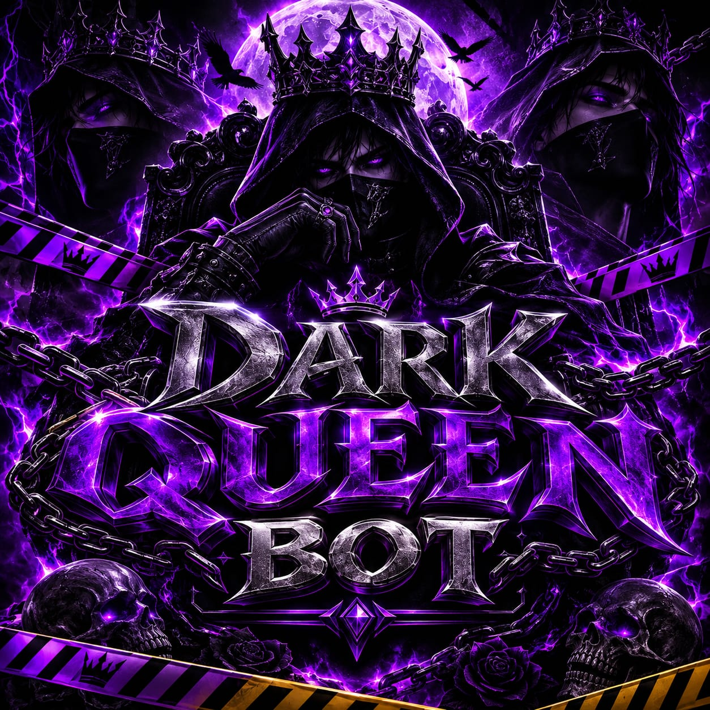

<!-- ╔══════════════════════════════════════════════════════════════╗ -->
<!-- ║                        DARK QUEEN BOT                          ║ -->
<!-- ╚══════════════════════════════════════════════════════════════╝ -->

<div align="center">


<br/>


<br/>


</div>

---

## 🩸 Sobre o Dark Queen Bot

O **Dark Queen Bot** é uma assistente de WhatsApp **multifuncional** de identidade sombria e soberana: música, figurinhas, jogos, economia, administração de grupos, proteções inteligentes e muito mais — com uma personalidade régia, elegante e profissional.

> Roda **24 horas** numa hospedagem (sem depender do celular) e também pode ser executada no **Termux**.

---

## 📸 Galeria

<div align="center">


&nbsp;


</div>

---

## 🚀 Recursos

| 🎵 **Mídia** | 🛡️ **Proteções** | 🎮 **Diversão** |
|---|---|---|
| Música e vídeo (yt-dlp direto) | Antifake (barra número fora do Brasil) | Jogos: forca, quiz, jogo da velha |
| Figurinhas / converter em GIF | Antitrava (escudo contra mensagens-bomba) | Economia, loja, duelos e ranking |
| Comandos `togif`, `toimg`, `s` | Antip • Antib • Antir • Antig | Brincadeiras e interações |
| Áudios e efeitos de voz | Antilink, antinota, antidoc, antiloc | Casais, amizades e compatibilidade |

| ⚙️ **Ferramentas** | 👑 **Administração** | 🤖 **Inteligência** |
|---|---|---|
| `nick` (vários estilos) e `tabela` | Lista negra (remove e bloqueia na entrada) | **Antinudes com IA** (detecção automática) |
| `geralink`, QR Code, encurtador | `nuke` (limpa o grupo — só dono) | **Auto-resposta** régia da Rainha |
| Cálculo, Base64, tradutor, clima | Boas-vindas e saída com card | Saudações automáticas |
| Menus com botões e listas | Mute, ban, antipalavrão, somente-adm | Respostas estilizadas |

---

## 📲 Instalação no Termux

**1. Prepare o Termux** (uma vez só):

```bash
termux-setup-storage
pkg update -y && pkg upgrade -y
pkg install -y nodejs git ffmpeg
```

**2. Baixe o bot do seu repositório:**

```bash
git clone https://github.com/DOCTOR-VALEYARD/DARK-QUEEN-BOT
cd DarkQueenBot
```

**3. Instale e ligue:**

```bash
npm install
npm start
```

> Na primeira vez o `npm install` baixa tudo (demora um pouco). O **yt-dlp** é baixado sozinho. Depois é só parear pelo **código** ou **QR Code** que aparece no terminal.

---

## ▶️ Ligar de novo (sem baixar tudo outra vez)

```bash
cd DarkQueenBot
npm run iniciar
```

---

## 🔄 Atualizar (quando sair versão nova)

```bash
cd DarkQueenBot
git pull
npm install
npm run iniciar
```

> O `git pull` baixa só o que mudou. Seus dados (login, grupos, economia) **não são apagados**.

---

## ⚙️ Configuração

As configurações principais ficam em **`config.js`** (prefixo, nome do bot, dono) e podem ser alteradas **pelo próprio bot** com o comando de configuração. Chaves pessoais (Mercado Pago, IA, etc.) **você coloca as suas** — elas não vêm no repositório por segurança.

---

<div align="center">

### 👑 Criado por **anjinho**


<br/>

*Dark Queen Bot © 2026 — todos os direitos reservados ao criador.*

</div>
